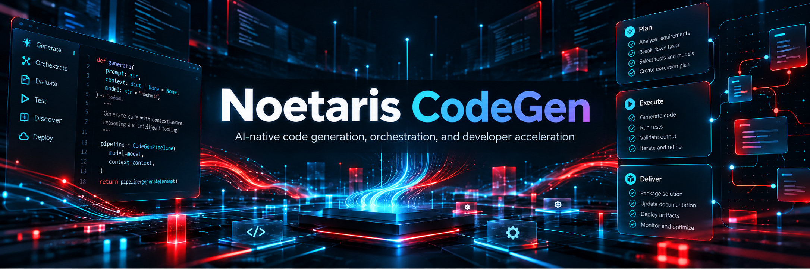

# Noetaris CoGen / NSAI

Experimental, noncommercial AMD hackathon research demonstration by the independent US project Mountain Nomad BC. Intended public audience: adults 18+, open supported Google/GitHub signup, no invitations. Public deployment is not complete. Local Docker review: **http://127.0.0.1:8790**.

The local candidate exercises document upload/indexing, MiniLM retrieval, source inspection, graph records, citations, separate review and guarded CPU Gemma answers. Source indexing does not retrain model weights or certify a document as true. Gated agent/studio/execution/voice features are not represented as operational.

Hosted AMD `Gemma-4-31B-IT` is the selected remote primary, with exact free OpenRouter Gemma variants as intended fallback. Automatic source-bearing hosted dispatch remains unfinished. R2 docs/images private Standard buckets pass synthetic checks, but application originals remain in PostgreSQL pending storage custody/quota integration. Neon PostgreSQL 18 is the deployed application database. Evolus is optional and NOT_CONFIGURED.

## Documentation

- [Current handoff](HANDOFF.md) and [delivery punch cards](docs/implementation/FINAL_DELIVERY_PUNCHLIST.md).
- [User guide](docs/USER_GUIDE.md), also available through the app's `/docs` page.
- [Terms](docs/legal/TERMS.md), [Privacy](docs/legal/PRIVACY.md), [AI transparency](docs/legal/AI_TRANSPARENCY.md), [upload restrictions](docs/legal/UPLOAD_RESTRICTIONS.md).
- [Privacy operations and outstanding review](docs/legal/GDPR_OPERATIONS_AND_RELEASE_REVIEW.md).
- [Local review](docs/deployment/LOCAL_REVIEW.md), [deployment topology](docs/deployment/MULTICLOUD_TOPOLOGY.md), [owner actions](docs/deployment/OWNER_ACTIONS.md) and [rollback](docs/deployment/DEPLOYMENT_AND_ROLLBACK.md).

Only publicly available, non-sensitive documents that users may legally process are allowed. The UI requires acknowledgment; server public-demo mode enforces its version. No secrets, proprietary/confidential/personal/medical/financial/regulated information. AI outputs must be independently verified. Actual deletion, retention, processor and contact gaps are disclosed; this repository is not a GDPR or production certification.

## Checks

```powershell
npm ci
npm --prefix frontend/noetaris ci
npm run build
.venv/Scripts/python.exe scripts/qualify_integration_regressions.py
.venv/Scripts/python.exe scripts/check_deployment_stages.py
```

The complete owned regression requires configured immutable Docker images and ignored local integration state; it rejects skips, source changes and incomplete cleanup. Current provider/account/hosting limitations remain in HANDOFF.md. No paid fallback or infrastructure provisioning is authorized.

Credentials, corpora, datasets, runtime databases, models, private audit archives and raw evidence are excluded from this public source backup. Source publication does not imply application release admission or public deployment.
