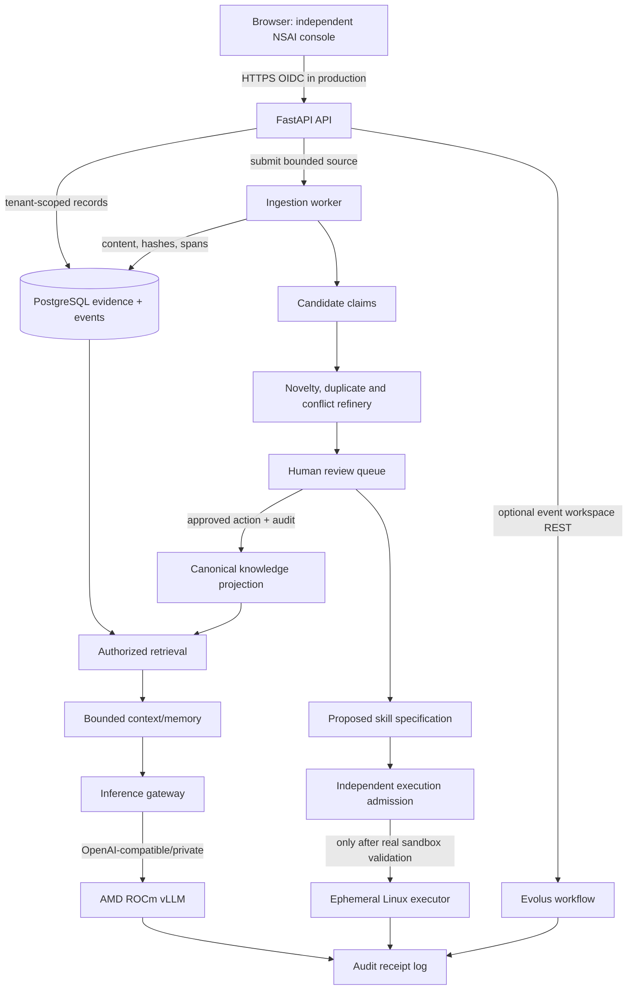

# NSAI target architecture — exact responsibilities and interface contracts

> Scope: architecture to build; labels `IMPLEMENTED`, `HELPER`, `PLANNED`, `DEFERRED` are not interchangeable.

## Ownership and deployment



**Never** place a direct API-to-Docker-socket edge, a model-to-canonical-DB-write edge, or a sandbox-to-Postgres network edge. GPU inference is not an authorization source. Remy is not running here.

## Module assignment / exact imports

| Responsibility | NSAI owner | Source reference | Current status | Gate |
|---|---|---|---|---|
| UI / chat | `assets/*` (event); optionally `apps/console` later | Remy assistant interaction ideas | Mini UI implemented | BASE, CHAT |
| API | `src/nsai/api.py` | Independent | Implemented / demo-local | BASE |
| Document storage | `src/nsai/store.py` and `deploy/init.sql` | Independent | Demonstration tables | DATA-03 |
| Canonical object schema | `src/nsai/contracts/evidence.py` | PX NSAI object semantics | Strict helper only | DATA-02/03 |
| Index/skill/authority envelopes | `src/nsai/contracts/lifecycle.py` | PX promotion models | Strict helper only | RET-04/AGT |
| Ingestion | `src/nsai/ingestion/` | Remy TurnBurn design only | Not built (regex demo in `models.py`) | ING |
| Content-addressed index | `src/nsai/retrieval/index_lifecycle.py` | Remy candidate/rollback design | Not built | RET-04 |
| Conflict handling | `src/nsai/models.py` then `src/nsai/evidence/refinery.py` | PX refinery ideas | Narrow regex conflict demo | EVD-01 |
| Human review & promotion | `src/nsai/evidence/promotion.py` | PX learning_promotion semantics | Gate helper only | EVD-02 |
| Temporal memory | `src/nsai/memory/temporal.py` | PX fabric and broker | Not built | MEM |
| Retrieval fusion | `src/nsai/retrieval/fusion.py` | Independently implemented | Pure helper | RET-03 |
| Audit chain | `src/nsai/audit/chain.py` | PX trusted evidence concepts | Unanchored digest helper | EVD-03 |
| AMD provider | `src/nsai/inference.py` | OpenAI-compatible standard | Adapter present, unverified on AMD | AMD-03 |
| Optional partner | `src/nsai/integrations/evolus.py` | Evolus documented API | Disabled client skeleton | EVO-03 |
| Container policy | `compose.yaml`; `deploy/amd/compose.amd.yaml` | Remy docker patterns + PX policy ideas | Static checks only | BASE-05/SEC-02 |

## API contract roadmap

Existing (demo-only auth uses local Bearer token):
- `GET /healthz` — process liveness, unauthenticated.
- `GET /readyz` — DB readiness (currently unauthenticated; do not expose public internals).
- `GET /v1/capabilities` — what is *actually* implemented.
- `POST /v1/documents` — JSON title, version, text, limited to narrow deterministic demo extractor.
- `GET /v1/documents` — metadata list; `GET /v1/claims` — candidate claims and conflicts.
- `POST /v1/chat` — deterministic candidate-only answer; `POST /v1/reason` — optional external model and **unverified** answer.

Planned API v1 additions (not implemented, do not present these as working):
- `POST /v1/files` upload bounded MIME-allowlisted source, returns job id.
- `GET /v1/jobs/{id}` job state + failure with authorization scope.
- `GET /v1/sources/{doc_id}/spans/{span_id}` source locator with role checks.
- `GET /v1/review` candidate review queue (authorized roles only).
- `POST /v1/review/{id}/decide` requires authenticated reviewer, signed/event receipt, concurrency version.
- `POST /v1/index-generations` stage candidate retrieval index.
- `POST /v1/index-generations/{id}/activate` separate index-only authorization.
- `POST /v1/skill-proposals` candidate descriptor only, **not code execution**.
- `GET /v1/evaluations/{id}` raw-case metric output.
- `POST /v1/workflows/{id}/execute` optional server-side Evolus action, server-side API key.

## Core method signatures to implement

```python
class Ingestor(Protocol):
    async def ingest(self, data: bytes, source_name: str, media_type: str,
                     project_id: str) -> IngestResult: ...

class EvidenceStore(Protocol):
    async def add_candidate(self, claim: CandidateClaim, project_id: str) -> str: ...
    async def at_observed_time(self, claim_id: str, as_at: datetime): ...
    async def at_valid_time(self, claim_id: str, effective_at: datetime): ...

class Retriever(Protocol):
    async def search(self, query: str, *, project_id: str, limit: int,
                     approved_only: bool = False) -> list[SourceHit]: ...

class ModelProvider(Protocol):
    async def generate(self, context: list[SourceHit], question: str) -> ModelOutput: ...

class PromotionAuthority(Protocol):
    async def decide(self, candidate_id: str, verified_actor: Principal,
                     evidence_receipt_id: str, expected_revision: str) -> DecisionReceipt: ...
```

### Protocol invariants

- All persistence records carry a project identifier when multi-tenant service begins; request-supplied `project_id` is never trusted in lieu of identity claims.
- `SourceHit` must refer to retrievable original source bytes, version and locator. A vector-only hit is never sufficient evidence.
- PromotionAuthority checks *external* signer/reviewer identity. A Pydantic `AuthorityDecision` object alone does not authorize any write.
- Retrieval result scoring and memory hypothesis ranking are separate from evidence validity.
- All timestamps UTC with timezone offsets; distinguish observed time (what NSAI knew) and effective time (when a technical statement was applicable).

## Data stores — no duplicate source of truth

1. `document_store` — hash/revision and source bytes; on a managed backend, store large bytes in private object storage and hashes in DB.
2. `candidate_ledger` — independently observable claims and relations.
3. `knowledge_projection` — materialized view of reviewed canon, rebuilt from immutable events.
4. `index_store` — disposable index generations; rollback independent from canonical promotion.
5. `working_memory` — job/session bounded, not canonical.
6. `workflow_logs` — runs, tool results, costs and external action receipts.

## Model behavior requirements

Grounded answer must separate **source statements** from **assistant inference**; if conflict unresolved, show both with citations and request review. Model instructions inside retrieved documents are untrusted data. Streaming, memory compaction and graph traversal must not silently change canonical truth.
