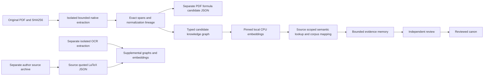

# arXiv research ingestion

This private qualification corpus contains 14 complete original PDFs across seven sampled topic pools. Sampling is seeded within bounded official metadata pools, rather than uniform sampling of all arXiv.

## Corpus

| Topic | Versioned arXiv source | Pages |
|---|---|---:|
| ai | [Finding Missed Code Size Optimizations in Compilers using LLMs](https://arxiv.org/abs/2501.00655v1) | 16 |
| ai | [Different thresholding methods on Nearest Shrunken Centroid algorithm](https://arxiv.org/abs/2501.00632v1) | 30 |
| physics | [Dirac-von Neumann Type Axiomatic Structure for Classical Electromagnetism](https://arxiv.org/abs/2501.01995v3) | 34 |
| physics | [Clifford circuits Augmented Matrix Product States for fermion systems](https://arxiv.org/abs/2501.00413v1) | 6 |
| computing_systems | [Towards Sustainable Large Language Model Serving](https://arxiv.org/abs/2501.01990v1) | 7 |
| computing_systems | [Interactive cybersecurity training system based on simulation environments](https://arxiv.org/abs/2501.00186v1) | 6 |
| economics_business | [A Certain Notion of Strategy Freedom under Retail Competition in Claims Problems](https://arxiv.org/abs/2412.19506v1) | 15 |
| economics_business | [An Evaluation of Borda Count Variations Using Ranked Choice Voting Data](https://arxiv.org/abs/2501.00618v2) | 19 |
| biology | [Poisson Network SIR Epidemic Model](https://arxiv.org/abs/2501.00187v1) | 13 |
| biology | [UNISEP: A Unified Sensor Placement Framework for Human Motion Capture and Wearables](https://arxiv.org/abs/2412.21159v2) | 13 |
| mathematics | [Boundaries of pseudointegral polygons](https://arxiv.org/abs/2501.00667v2) | 22 |
| mathematics | [On the zeros of linear combinations of L-functions of degree two on the critical line. Selberg's approach](https://arxiv.org/abs/2501.00551v1) | 23 |
| linguistics | ["Dialogue" vs "Dialog" in NLP and AI research: Statistics from a Confused Discourse](https://arxiv.org/abs/2501.00598v1) | 10 |
| linguistics | [MCP-Solver: Integrating Language Models with Constraint Programming Systems](https://arxiv.org/abs/2501.00539v2) | 26 |

## Knowledge assembly

The ingestion transaction stores original bytes, exact normalized span mappings, lexical search chunks, typed knowledge observations, formula candidates and a bounded evidence-memory projection together. Failure in structured assembly rolls the source transaction back. Original observations retain source identity, revision, locators, quote offsets, wording cues for negation/conditions and heuristic roles. They do not automatically become reviewed canon.

A pinned local all-MiniLM-L6-v2 ONNX encoder produces 384-dimensional vectors for grouped source passages. Every passage and tokenizer window must have a matching coverage receipt. Semantic lookup uses bounded exact cosine with explicit source and model scope. The corpus map adds three candidate semantic neighbours per document. Similarity and lexical mentions do not imply causation or factual agreement.



## Separate mathematical and visual representations

`formulas.json` quotes mathematical-looking regions from native PDF text with original-PDF digest, span digest, page, locator and exact Unicode offsets. It deliberately does not claim lossless equation recognition or mathematical correctness. Author-source `formulas-author-source.json` retains actual delimited LaTeX and its separate archive/file hashes and offsets. Author TeX is supplemental evidence: rendered equivalence and PDF page alignment are unverified. No TeX commands, includes, macros or formula expressions are executed.

Five PDFs have complete bounded native visual coverage; nine have explicitly recorded figure/form gaps. OCR enrichment preserves native text and formula precision in their original artifacts and stages OCR evidence separately. English OCR is uncalibrated for these papers; mathematical recognition is unsupported. Processing availability and scientific accuracy are separate.

## Local use

The prepared corpus is in `data/arxiv-corpus/ingestion-000adc1c3be1/manifest.json`. Each document directory contains `original.pdf`, `parsed.json`, `knowledge.json`, `formulas.json`, `memory.json` and `embeddings.json`. Every file has a digest in the private manifest. `corpus-map.json` and `document-semantics.json` record the automatic document mapping. Originals, author archives, raw metadata, vectors and derived paper content remain private and are excluded from Docker build context.

Use the existing host Python with the optional CPU encoder packages to query the staged corpus:

```powershell
python scripts/query_arxiv_corpus.py --current --question "How can we reduce energy usage when serving large language models?" --limit 3
```

The query returns source excerpts, exact span segments, candidate formulas, provenance graph links and evidence-memory identifiers. It does not label a generated answer verified. New candidate API surfaces are `GET /v1/knowledge/{id}`, `GET /v1/knowledge/{id}/formulas`, `POST /v1/knowledge/{id}/embeddings` and `POST /v1/knowledge/semantic-search`. Ordinary uploads automatically assemble structural knowledge; their embedding status remains `awaiting-local-encoder` until the local worker supplies a complete pinned-model generation.

## Testing and evidence

Current native corpus totals: **240 pages; 1,233 semantic passages; 176,729 tokenizer tokens covered; 40,264 graph nodes; 62,433 within-document edges; 2,422 native PDF-text mathematical candidates**. Author-source acquisition produced **3,183 quoted LaTeX candidates across 13 TeX-bearing papers**; one source endpoint returned only PDF and remains explicitly partial.

Seven frozen broad exploratory queries returned the expected topic in the top five for six topics. The broad mathematics query missed. This is a small exploratory result, not an independently held-out scientific or semantic accuracy qualification. The energy-utilization query returned three passages from *Towards Sustainable Large Language Model Serving*, with source/page/graph links.

Fresh validation, failures and repairs are retained under `evidence/arxiv-ingestion/`, separate from deployment material. The final database/restore and OCR enrichment receipts must be consulted for their exact status and scope; native text coverage is never silently promoted to full visual or mathematical coverage.

## Deployment and resource boundary

The existing live Docker application remains unchanged. Research ingestion is qualified in owned isolated resources with no published ports or user-volume access, and durable private artifacts are retained. The full application release guard still applies. Central security, generated execution, AMD and Evolus activation remain disabled. The optional encoder is approximately 91 MB of assets with two CPU threads; no additional generative model or GPU service is started. Paper licenses are recorded individually; local acquisition is not public redistribution approval.

## Final scoped qualification (2026-10-14)

The current navigation catalog is `data/arxiv-corpus/current.json`; its prepared and supplemental manifests are SHA-bound. `evidence/arxiv-ingestion/current.json` links immutable evidence receipts. This catalog selects private staged artifacts for the local query CLI; it does not activate a live database index.

Fresh results: 620 unit checks passed, one optional dependency check skipped; the optional encoder contract separately passed all 17 checks using the host CPU runtime. The isolated corpus/database qualification passed 453 checks, including 14 sources, 23 supplement records, immutable evidence, permissions, transaction rollback and an actual compressed backup restoration. The separate full-stack qualification passed 31 cases, including browser/PDF workflow and owned-resource cleanup. These counts describe different scopes and are not a certification score.

OCR processed 33 of 35 requested visual-gap pages. UNISEP pages 12 and 13 have unsupported rotated geometry and remain explicit gaps. One author-source endpoint supplied PDF rather than TeX. OCR accuracy, formula correctness and rendered TeX/PDF equivalence remain unqualified. The frozen exploratory mathematics retrieval miss remains recorded.

Two defects found through actual execution were repaired and checked: literal quote characters in Tesseract TSV were incorrectly interpreted as CSV quoting; Windows credential cache identity could alias after a same-size file replacement. The cache reproduction changed from 23 stale reads in 100 baseline attempts to zero in 100 repaired attempts. Live credentials were not rotated.

API candidate: `sha256:634ca041540549ddd7821492aede6bc73d347360f34b68fdf366eb709daab913`. OCR candidate: `sha256:b2a44294db267cb9eb4d3ef4c245495b674304b78377e853eaaeb9aa18fb10e0`. Both are retained by explicit hold tags. This evidence does not transfer previous image vulnerability results to these images. The live application remains on its prior image. Full-plan acceptance and security/release approval remain outstanding.

## Later engineering validation extension

The later candidate is `4bd1f8c08869`, separately built and checked:706unit passes,31owned stack cases,587owned corpus/database cases and57exact unmounted runtime file matches. Its new read-authorized `/v1/knowledge/{document_id}/units` projection preserves source text/offsets and emits only provisional formatting/quality interpretations. A separate private generation `data/arxiv-corpus/document-units-50acd42328ee/manifest.json` stores13,831units across14documents without changing previous knowledge generations.

Independent supplement/map oracles cover all23records and14/42map nodes/edges; deliberately removed inventories, foreign locators, fabricated similarities and invented quotes are rejected. A reviewer-found missing-inventory defect was fixed and independently retested. See [execution details and remaining gates](../../plans/implementation/RELEASE_VALIDATION_EXECUTION.md). Earlier candidate references above remain historical, not current release qualification.
