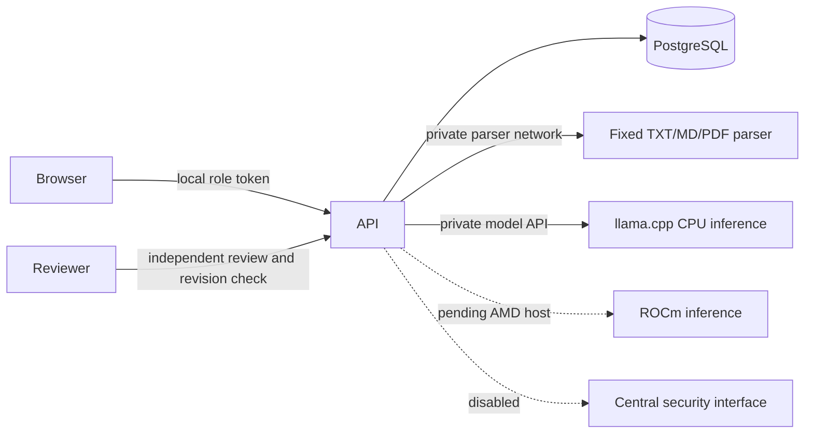

# Current architecture extension and provenance boundary

The research candidate adds immutable native knowledge and formula artifacts, a pinned optional local CPU encoder with complete token-window receipts, separately namespaced OCR/author-source graphs, candidate evidence memory and document similarity mapping. A new versioned document-unit projection preserves source quotes and offsets without rewriting original knowledge generations. Unit and section types remain provisional formatting interpretations. See [corpus architecture](../implementation/ARXIV_CORPUS.md).

New reference material is used only as research guidance; no additional private source bodies, dictionaries, fixtures, company UI or assets were imported. The legacy vendor names now use original NSAI contracts and compatibility adapters; the older imported source-adoption ledger is historical. Exact archive, dependency/model rights and historical-record compatibility still require the original provenance card's independent disposition. This project must not be represented as globally clean-room merely because newer modules are original.

The original architectural snapshot follows. Its deferred-semantic statement is historical; its provenance descriptions are retained for review rather than erased.

---

# Architecture and component provenance

NSAI is a private, single-project document evidence workspace. Browser requests enter a loopback
FastAPI API. PostgreSQL stores immutable original bytes, normalized spans, candidate claims,
content-addressed chunks, review projections, scoped conversations, learning proposals and audit events.
PostgreSQL full-text retrieval supplies real source excerpts to an OpenAI-compatible model adapter.
The CPU demonstration backend is llama.cpp using an existing validated local GGUF. Ollama remains
an optional adapter/profile; AMD vLLM is a separately validated future backend.

Selective reuse is real and bounded. Pacify-X's memory query-plan class, deterministic identity,
builder and validator are adapted into `nsai.vendor.px_memory_plan`. Its original hash helper is
inlined to avoid the fabric/intelligence dependency tree. Apache-2.0 license and upstream NOTICE
are retained. Source and adopted file SHA256 values are recorded in `docs/component-provenance.json`.
This is not the complete PX memory fabric, broker or Gremlin implementation.

Remy/RIE's self-contained TurnBurn manifest module is imported into `nsai.vendor.remy_manifest`.
Typed manifest models run in the ingestion transaction and preserve source metadata. Its filesystem
loader is not exposed through the API. Reuse is authorized for this private build; it is not labeled
MIT or included in the documentation-only public-safe preview. No proprietary corpora, logos,
customer data or company UI assets are copied. The UI is original code informed by Remy's interaction patterns.

Pacify-X CLI startup was exercised with metadata-only loading. Doctor reported broader control-plane
blockers. Those raw results are retained; this application does not claim a commissioned or certified
PX control plane. Imported behavior is verified through focused unit and live integration tests.
The local partial `.agentic_engineering_os_px` bootstrap was not treated as an operational runtime.

DVA/EY cost-governor source was read as a design reference only. No DVA code was copied. NSAI uses
an original transactional UTC daily inference-attempt ceiling, concurrency bound, output token budget,
and administrative kill switch. Dollar costs and ROCm instance billing are not measured or enforced here.

Sources and audit are authoritative CPU database operations; model suggestions do not grant authority.
Semantic embeddings, full TurnBurn staging/rollback and advanced multi-agent orchestration are deferred.
