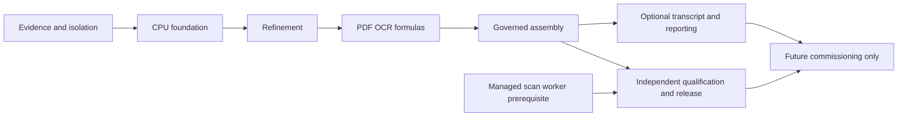

# Complete implementation plan and punch cards

This is the actionable successor to the audit’s coarse work packages. It plans repairs and independently authored integrations; it does not change production, deploy, or activate providers. The current CPU system remains the baseline. Central security and generated execution stay disabled. AMD/Evolus work remains deferred.

The backlog contains **89 punch cards**, covering all 16 CORE findings, all 12 OPS findings, supplementary findings, qualification gaps and reference capability decisions. Every reference-table row has an adoption allocation, including metadata-only rows; that allocation does not upgrade the depth of the reference audit.

## Order and gates

A → B → C → D → E is the required functional path: evidence admission, foundation repair, refinement, PDF/OCR/formulas, then governed assembly. F is an optional local capability branch after E. G independently qualifies and releases the resulting CPU system. H documents future boundaries and authorizes no activation.

The dedicated security environment prerequisite can be resolved alongside B–E. Coverage work starts after B and expands for every new active feature. Optional F is not required for a B–E release unless selected as release scope. AMD/Evolus commissioning depends on a stable local release and selected workload, never on a target-directory name.

## Punch cards

- [A: Planning and evidence infrastructure](A_PUNCH_CARDS.md) — 3 cards.
- [B: Required CPU foundation repairs](B_PUNCH_CARDS.md) — 29 cards.
- [C: Evidence, retrieval and performance refinement](C_PUNCH_CARDS.md) — 17 cards.
- [D: Private PDF workspace, OCR and formulas](D_PUNCH_CARDS.md) — 10 cards.
- [E: Governed assembly and inactive central integration](E_PUNCH_CARDS.md) — 9 cards.
- [F: Optional local transcript and business capabilities](F_PUNCH_CARDS.md) — 10 cards.
- [G: Independent qualification and controlled release](G_PUNCH_CARDS.md) — 6 cards.
- [H: Deferred commissioning boundaries](H_PUNCH_CARDS.md) — 5 cards.

## Tracking and completeness

- [Machine-readable backlog](backlog.json) is authoritative for dependencies, acceptance and status; [CSV tracker](tracker.csv) supports sorting and assignment.
- [Finding coverage](finding-coverage.json) maps every numbered finding and newly numbered supplementary/gap item.
- [Reference adoption ledger](reference-adoptions.json) retains each table-row decision and relevant independent implementation cards.
- [Starter reconciliation](starter-reconciliation.json) accounts for all 50 original source-matrix entries under the latest architecture-only instruction.
- [Audit note coverage](audit-note-coverage.json) preserves supplementary bullets, adoption hazards, mathematical requirements and coverage limitations with card allocations.
- [Capability coverage](capability-coverage.json) maps all 31 capabilities.
- [Function allocation](function-allocation.json) allocates the complete 198-function inventory and preserves routes and inline UI handlers. Allocation is not proof that every branch has been tested.
- [Plan validation](plan-validation.json) checks dependency cycles, required findings, mappings and unchanged baseline hashes.

## Opening, completing and reopening a card

Move PLANNED → READY only after prerequisites and isolation are available. Then IN_PROGRESS → VERIFYING → ACCEPTED after fresh evidence and independent review. Track BLOCKED with exact cause, not as accepted. Use DEFERRED for the H boundaries; their contracts can be documented without activation. Reopen a card if source/configuration/dependency changes invalidate its receipts. Add newly discovered findings to the coverage registry and a linked card before claiming completeness.

Assign one implementer and a separate verifier to each card. Reserve owned test resource names and ports, avoid concurrent schema/live-policy writes, and split changes into independently reviewable patches. Never delete user volumes. No source-copy import scripts, corporate assets/dictionaries/data or pretrained private artifacts may be introduced. Independently implement generic functions from the written contract. Existing imported code is explicitly resolved by the provenance card before clean-room or licensing claims.

## Release boundaries and recovery

A foundation repair release can be cut after B with the corresponding G qualification subset, keeping unfinished C–F capabilities visibly unsupported. The complete integration release requires C–E and full relevant G checks. F is optional; H requires new explicit activation instructions. No ordinary implementation card bypasses the release gate.

For each release: freeze accepted scope and image/configuration hashes; run offline checks/build before schema mutation; take and verify a protected backup; rehearse upgrade and prior-image compatibility on a clone; deploy the immutable CPU image; verify source-image binding/readiness and rollback triggers. Roll back on failed health, integrity, RBAC, resource containment or required quality checks. Preserve failed receipts and reconcile incomplete reservations. Schema rollback uses the tested compatibility/restore procedure rather than destructive guessing.

## Testing and evidence — separate from deployment

Test results are a separately inspectable deliverable, not deployment instructions or automatic deployment approval. Use `evidence/implementation/<card-id>/` for private raw evidence and an independently reviewed redacted submission projection. A receipt includes UTC run identity, source/image/configuration/input hashes, tools/runtime versions, exact command/exit status, isolation scope, expected/actual cases, retained failures and reviewer verdict.

Begin with audited reproductions from `evidence/audit/`: PDF negative probes, non-ASCII authentication, Unicode output budget, overflow token admission, browser logout, empty-service/evidence admission and idempotent inference races. Reproduce on a disposable baseline, then run the same oracle against the candidate. Run runtime checks under container Python 3.12 as well as declared host support; historical 57-test PASS remains historical.

Use unit/property/fuzz cases for contracts and bounds, disposable real PostgreSQL/API integration for transactions and RBAC, actual Chromium for role transitions/scoped PDF/private data clearing/accessibility, and real CPU inference for tokenizer/admission/transport. Mocked model transport does not certify real inference. Isolated OCR must prove actual network/credential/resource restrictions, not environment flags alone.

Benchmarks freeze corpus/model/source/image/configuration and workload; label cold/warm, concurrency, queueing, sample count and units. Predeclare sampling and quality tolerances; n=5/max does not establish production p95. Compare relevance/support/refusal/CER/WER/critical-token/geometry quality alongside latency/resources. OCR numeric targets remain provisional until calibrated on independent source-family holdouts; unsupported input stays explicit.

Dedicated Deep Scan has not started: the tool requires a managed read-only filesystem permission profile. The prerequisite and requalification are explicit cards. No dedicated-scan PASS or overall security-ready claim is permissible while blocked. Current operational checks do not replace that missing qualification. Do not weaken global permissions or fabricate canonical scan artifacts.

Submission review checks the exact archive membership, secret/privacy/license disposition, hashes, traceability and capability honesty; no publication is authorized by this plan. Evidence is filtered, never copied wholesale from private references or production corpora.

## Reproducible planning checks

Run `python plans/implementation/build_plan.py` from the project root to regenerate and validate these planning artifacts. This generator writes only its own plan directory and never runs Docker, migrates the database or reads secret contents. Update structured card rows and explicit mappings first, regenerate, then review the human-readable cards. During implementation update status/evidence fields in a maintained execution tracker rather than regenerating away execution history; this file describes the initial planned baseline.

## Appended engineering release checklist (2026-10-14)

The user-supplied full engineering checklist is incorporated in [I: Release validation punch cards](I_RELEASE_VALIDATION_PUNCH_CARDS.md): **18 additional work packages and 209 individually mapped requirements**, including all checkboxes, 18 adversarial scenarios, 11 evidence fields and ten final challenge steps. The [extension ledger](release-validation-extension.json) and [CSV tracker](release-validation-tracker.csv) supplement the original 89-card backlog; both ledgers must be consulted. The original generator does not regenerate this separately maintained extension.

The [nine additional research cards](../../docs/implementation/REFERENCE_RESEARCH_EXTENSION.md) remain linked as REF-01 through REF-09 in the extension. These REF identifiers belong to the additional-research namespace; they are not the older finding IDs named REF in the original backlog.

Read the extension's scope decisions and dependency order before beginning further implementation. No production code was changed in this checklist integration pass. Existing execution-status documents describe historical candidate scopes; current arXiv evidence is indexed separately in `evidence/arxiv-ingestion/current.json`. No historical test count accepts a release requirement automatically. AMD/Evolus, central activation and optional voice remain outside current active scope. The unseen-subject challenge requires a fresh untouched subject beyond the seven development-corpus topics.

Validate checklist coverage with `python plans/implementation/validate_release_extension.py`. This validates planning coverage and references, not product correctness or release readiness.

Current implementation progress for the appended checklist is recorded separately in [release validation execution](RELEASE_VALIDATION_EXECUTION.md) and its [structured tracker](release-validation-execution.json). Planning coverage remains distinct from implementation and acceptance.

The [current507-function allocation](current-function-allocation.json) supplements the original historical198-function planning inventory. Entry observation, card allocation and named workload timings are distinct from complete branch coverage or individual benchmarks. The release guard now enforces the appended209-requirement acceptance document as well as the original foundation/security gates.

## Remaining repair, unblock and completion sequence

The current end-to-end execution overlay is
[M: Completion and certification](M_END_TO_END_COMPLETION_AND_CERTIFICATION.md),
requested 2026-10-15. Its 22 packages carry forward all J/K/L requirements and put
independent acceptance of a running CPU reference release before Evolus/AMD
preparation. See its [execution tracker](end-to-end-completion-tracker.csv) and
[planning-only validation](end-to-end-completion-validation.json). No requirement
or release gate is accepted by this planning overlay.

[J: Repair/unblock/completion plan](J_REPAIR_UNBLOCK_COMPLETION_PLAN.md) consolidates all remaining implementation, quality, security, host-prerequisite and release work into24 dependency-ordered packages. Its [machine plan](completion-repair-plan.json), [tracker](completion-repair-tracker.csv) and [validation](completion-repair-validation.json) cover all89 original cards/301 criteria,209 checklist requirements,9research additions and507 catalogued functions. The overlay preserves original criteria/dependencies and does not weaken the pinned release extension or accept work by mapping it.

Use this sequence for remaining work. Resolve the managed scan environment alongside independent implementation; keep central activation, generated execution and AMD/Evolus deferred. Rebuild/qualify/freeze before controlled CPU release, and keep testing/evidence separate from deployment.
